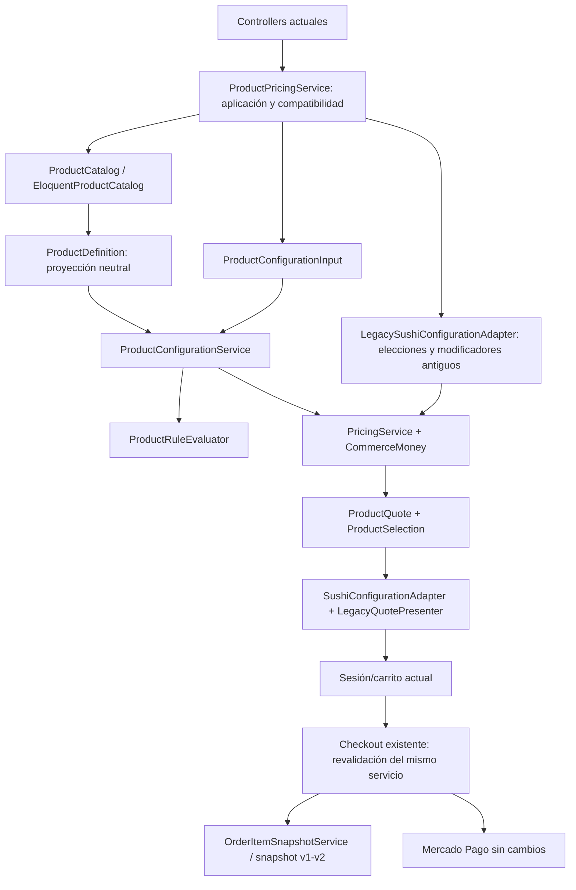

# G1 — Contratos y núcleo comercial neutral

Fecha: 26 de octubre de 2026. Implementación en `D:\akila`, sin integrar ACSoft, tenancy, branding nuevo ni interfaces administrativas nuevas.

## Alcance y relación con G0

Este encargo redefine G1 como **contratos + núcleo neutral**, adelantando parte del G2 técnico del roadmap G0. Los cuatro documentos G0 se conservan como auditoría histórica; sus propuestas de integración no autorizan agregar negocio_id, mover archivos a ACSoft ni fusionar sus productos en esta fase.

Objetivo: cotizar y registrar producto simple, café, hamburguesa, polera y catálogo Sushi con el mismo núcleo de selección/reglas/precios y snapshots, preservando datos, precios, identidades, contratos de carrito y presentación pública de Akila. Se conservan clases y tablas españolas. No se reescribe checkout ni Mercado Pago.

## Antes y después

Antes, ProductPricingService mezclaba dispatch, validación gastronómica legacy y aritmética monetaria; MenuConfigurationService mezclaba selección genérica, reglas, slugs culinarios y presentación. PromotionRuleEvaluator infería roles desde slugs. Los productos sin configuración caían al cotizador de ingredientes.

Después:



El motor de `Configuration`, `Pricing`, `Orders`, `Catalog` y `Exceptions` no contiene roll, salmón, proteína, vegetal, pieza, salsa, ingrediente ni reglas por nombre de comida. No consulta Eloquent: recibe una definición con escalares/arrays explícitos y trabaja en memoria. La proyección Eloquent y los adaptadores son fronteras; no se presenta todo `App\Commerce` como código independiente del esquema histórico.

## Namespace y contrato de producto

Namespace elegido: **App\Commerce**, consistente con servicios/clases Laravel existentes sin agregar una jerarquía DDD ni repositorios por modelo.

`App\Models\Producto` sigue siendo la identidad comprable **Commerce Product**. `ProductDefinition` expresa nombre, descripción, slug, precio base, disponibilidad, personalizable, unidad/contenido incluido, grupos, bloques, componentes opcionales, reglas y políticas. No expresa inventario ni stock.

El `Producto` de ACSoft Gestión sigue siendo otro contrato: código, precio_venta, unidad física/comercial y StockMovimiento. No se fusionan ni sincronizan aquí. En una integración posterior se necesitará un vínculo/mapeo explícito y decisión de autoridad de precios/stock, conservando las referencias de pedidos. La decisión anterior de generalizar Akila primero e integrar como módulo interno continúa vigente.

La única interfaz nueva es `ProductCatalog`, registrada con `bind(ProductCatalog::class, EloquentProductCatalog::class)` en `AppServiceProvider`. Representa la frontera de catálogo real que podrá sustituirse al integrar. Los demás servicios son clases concretas resueltas por el contenedor: no necesitan interfaces ceremoniales. No hay singleton mutable ni resolver de negocio.

## Contratos creados

| Contrato | Responsabilidad |
|---|---|
| Catalog/ProductDefinition | Datos comerciales explícitos, sin serializar relaciones Eloquent completas |
| Contracts/ProductCatalog | Convertir la identidad Producto actual a definición comercial |
| Configuration/ProductConfigurationInput | Forma estructural, independiente de HTTP: bloques/IDs/opciones/componentes removidos |
| Configuration/ProductSelection | Elecciones normalizadas y ordenadas, separadas de la cantidad comprada |
| Pricing/ProductQuote | Producto, cantidad, precio base, modificadores, precio unitario/final, detalles, cargos y configuración |
| Exceptions/ConfigurationException | Código de dominio estable (`reason`), contexto y compatibilidad con ValidationException |

Los arrays internos de grupos/opciones/reglas tienen claves inglesas. No se crean modelos paralelos Option/OptionGroup para duplicar GrupoOpcion/Opcion. El DTO no acepta precios, importes ni recargos del navegador. Los endpoints mantienen la validación HTTP de identidad/cantidad; el normalizador de aplicación construye el DTO de configuración y el motor valida la pertenencia y validez comercial.

Ejemplo de uso interno neutral, sin HTTP:

```php
$definition = app(ProductCatalog::class)->definition($producto);
$input = ProductConfigurationInput::fromArray(['option_ids' => [$optionId]]);
$quote = app(ProductConfigurationService::class)->quote($definition, $input, 2);
$snapshot = app(CoreOrderItemSnapshotService::class)->fromQuote($definition, $quote);
```

Los nombres cortos del ejemplo corresponden a App\Commerce\Contracts, Configuration y Orders. Para los consumidores actuales existe `App\Services\ProductPricingService::quoteResult()` (ProductQuote), `quote()` (array histórico) y `toArray()` (proyección de compatibilidad). Los controllers de carrito ya utilizan el resultado tipado antes de serializarlo a la sesión/JSON de siempre. `refreshCart` vuelve a cotizar mediante el mismo camino, incluido checkout.

## Selección, reglas y dinero

ProductConfigurationService hace una única selección por contexto: valida bloques pertenecientes al producto, grupos activos, opciones asignadas/activas/disponibles, unicidad dentro del ámbito, mínimos/máximos y componentes removibles. Rechaza IDs que simplemente existen pero no están asignados. No adivina una elección incompleta; conserva únicamente la resolución automática anterior de composiciones fijas singleton.

ProductRuleEvaluator recibe tipos/sujetos neutrales: `max_repetitions`, `exclude`, `minimum_units`, `surcharge`, `included_quantity`, `incompatible`. Mínimo/máximo/selección requerida pertenecen a cardinalidad del grupo; los recargos pueden proceder de opciones o reglas. La infraestructura `included_quantity` conserva su semántica anterior: no se afirma haber implementado una política universal de primeras N unidades gratis.

Se agrega el tipo PHP `TipoReglaPromocion::Incompatible`, valor `incompatible`, sobre el VARCHAR existente. Usa sujeto opción/componente y `metadata.option_ids` para las opciones incompatibles; el modelo valida lista entera distinta no vacía. Es una restricción condicional, distinta de excluir siempre una opción. No se añade ninguna regla al catálogo real. No hay fórmula ejecutable ni DSL.

Errores de dominio: required_selection, too_many_selections, invalid_option, option_unavailable, invalid_blocks, fixed_configuration, max_repetitions, excluded_option, incompatible_options, invalid_removal, entre otros. El adaptador conserva los mensajes españoles específicos de Akila donde corresponde. El motor produce errores neutrales y no depende del HTTP Request ni de nombres de comida.

**PricingService es el único cálculo base + cargos + cantidad**, también utilizado por el fallback antiguo. ProductQuote guarda importes en enteros de centésimas, exactamente la estrategia de MenuMoney anterior, y expone strings decimales en su serialización neutral. BasePrice y modifierTotal son por presentación comprada; total multiplica su suma por quantity. CommerceMoney es la implementación anterior de BigDecimal trasladada sin cambiar redondeo/escala ni agregar librerías. MenuMoney queda como nombre compatible heredado. Los floats del array público, checkout/SDK y el formato monetario anterior se conservan; una reforma monetaria más amplia queda fuera.

## Cantidad, unidades y bloques

Cantidad comprada (`ProductQuote.quantity`, carrito/order_items.unidades) y contenido (`ProductDefinition.includedQuantity`, productos.unidades) son independientes. Dos cajas con doce unidades cuestan dos veces el precio de la caja, no veinticuatro veces.

El Core no exige bloques, componentes físicos ni piezas. La unidad comercial es un identificador de datos; la proyección usa los valores actuales del enum sin convertirlos en requisitos del motor. Una figura/polera usan unidad_tipo=unidad. No se promete todavía cantidad fraccionaria o alta administrativa de nuevas unidades kg/pack.

BloquesPromocion se proyecta como Configuration Block con nombre, orden, cantidad, unidad y grupos. El esquema existente permite `cantidad_piezas=null` con `cantidad_unidades` y `unidad_tipo=unidad`: demostrado en tests. Las políticas de igualdad de unidad y suma de contenidos se aplican explícitamente para el catálogo gastronómico existente; el motor acepta bloques neutrales sin esa imposición, conservando esas relaciones y sus IDs.

## Adaptadores y compatibilidad

| Clase | Qué conserva/aisla | Retiro futuro |
|---|---|---|
| Compatibility/SushiConfigurationAdapter | Inferencia histórica de roles por slug; traducción reglas/campos, salsas/preparación/base, mixtos, schema y mensajes públicos | Tras migrar políticas/roles a datos explícitos y consumidores públicos, no durante G1 |
| Compatibility/LegacySushiConfigurationAdapter | envoltura_id/Proteínas/vegetales/cream_cheese/scallions, múltiplos de diez, sustituciones, límite por salm y +1000 legacy | Tras migración explícita de productos/carritos legacy; nunca retirar por simple renombre |
| Compatibility/LegacyQuotePresenter | Array de sesión/JSON con campos españoles e importes anteriores | Cuando los consumidores utilicen el contrato neutral versionado |
| Services/MenuConfigurationService | Facade para supports/quote/schema existentes | Tras migración de controllers/componentes; no borrar ahora |
| Services/PromotionRuleEvaluator | API histórica utilizada por schema/fixtures | Tras migración de esos consumidores |
| Services/MenuMoney | Alias de implementación neutral única | Puede mantenerse sin costo funcional |
| Services/OrderItemSnapshotService | Entrada array anterior o ProductQuote; mapeo hacia constructor único de snapshot | Tras migración de consumidores de array |

El fallback antiguo no conserva otra fórmula de precio: normaliza/valida sus elecciones y convierte sus sustituciones en cargos; delega el total a PricingService. Se permite la compatibilidad específica temporal solicitada, sin afirmar falsamente que la detección salm fue convertida a filas de datos en esta fase.

`EloquentProductCatalog` carga relaciones explícitas y convierte los campos legacy a definiciones. Los tipos culinarios opcionales pueden viajar como metadata descriptiva de componente, pero el motor no decide con ellos. El actual criterio de catálogo gastronómico para políticas homogéneas sigue en esta frontera; en G2 debe reemplazarse por configuración explícita aprobada. Los slugs de grupos tampoco son el diseño futuro definitivo.

Los hashes conservan el algoritmo SHA-256 sobre producto/configuración canónica; **la cantidad comprada queda fuera** para que iguales configuraciones consoliden cantidad, como antes. La proyección histórica mantiene orden de claves, `pieces`, `unit_type/units` y removed_base_ids de los productos actuales. El DTO neutral usa quantity/unit_type y removed_component_ids. No se reescriben las sesiones existentes para un cambio cosmético de representación.

## Snapshots e historia

`App\Commerce\Orders\OrderItemSnapshotService` construye snapshots autocontenidos de producto, cantidad, importes, configuración, selecciones y cargos. La fachada conserva el array público actual y acepta también ProductQuote. Sigue habiendo lectores/escritores v1/v2, **sin v3 innecesaria** ni actualizaciones de snapshots existentes.

Las pruebas cambian nombre/precio/opciones después del pedido y comprueban que nombre, importes y selecciones históricas permanecen iguales. El snapshot tipado neutral también se verifica directamente. OrderItem mantiene su bloqueo Eloquent de reemplazo. Esto no se presenta como un trigger SQL ni como protección contra cualquier escritura directa: esa deuda histórica no cambia con G1.

## Mapa Sushi → Core

| Concepto actual | Concepto Core | Estado después de G1 |
|---|---|---|
| Producto | Commerce Product / ProductDefinition | Modelo/tabla/IDs conservados; separado contractualmente de stock ACSoft |
| MenuConfigurationService | ProductConfigurationService | Facade conservada; selección real neutral |
| ProductPricingService | Aplicación + PricingService | Dispatch y compatibilidad; aritmética central única |
| PromotionRuleEvaluator | ProductRuleEvaluator | Wrapper; evaluación genérica por tipo/ID |
| MenuMoney | CommerceMoney | Implementación única, nombre anterior compatible |
| BloquePromocion | Configuration Block | Relaciones existentes; unidad/cantidad neutrales en Core |
| GrupoOpcion | Option Group | Mínimo/máximo y asignación reutilizados |
| Opcion | Option | Sin ingrediente obligatorio; recargo/estado existentes |
| ReglaPromocion | Product Rule | Proyección neutral; incompatibilidad aditiva en enum PHP |
| Ingrediente | Optional Food/Recipe Component | No requerido por selección ni precio genéricos |
| producto_swappable_ingredient | Legacy food substitutions | Solo compatibilidad; no base del Core nuevo |
| OrderItem.snapshot | Historical commercial snapshot | Mismo contenedor/versiones, sin consultar catálogo para leer historia |

## Usuarios: contrato, sin integración

- Administrative user: identidad autenticada con autorización administrativa actual. En ACSoft se mapeará a User + membresía negocio_user/rol/módulo, no a is_superadmin automáticamente.
- Customer: comprador registrado/relación comercial; no adquiere membresía administrativa por comprar. No equivale al Cliente de ACSoft que es dueño de negocios.
- Guest customer data: nombre/contacto/dirección capturados en Order; no requiere User ni inventa cuenta administrativa.

Los servicios nuevos de catálogo/configuración/precio no reciben ni infieren roles o usuarios. Checkout y OrderAccess conservan sus controles actuales; esta fase no agrega RBAC, Negocio ni customer models nuevos.

## Migraciones e integridad

**Cero migraciones, cero cambios de esquema y cero escrituras comerciales persistentes.** Sin columnas/IDs renombrados, sin negocio_id, sin seeders modificados/ejecutados sobre MariaDB. Las pruebas usan SQLite :memory: y sus fixtures/seeds aislados; el gateway está simulado.

Antes y después: 37 productos, 35 activos, 2 Gohan inactivos, 3 pedidos, 5 líneas históricas. Se tomaron hashes de contenido completo y DDL de las 26 tablas en transacción READ ONLY, sin imprimir PII ni secretos. También se caracterizaron cotización/schema de los 35 activos. Comparaciones tras el refactor/Pint y al cierre: **cero diferencias** en sus arrays serializados, incluidos precios/cargos/configuración/hash/schema; **cero diferencias de contenido o DDL** en las 26 tablas persistentes.

Los cambios previos del working tree se conservaron. Se comparan hashes de .env, seeders, migraciones, JS/CSS/Blade, pagos, checkout y assets contra el inicio para no atribuir a G1 trabajo anterior. ACSoft se mantuvo en lectura de modelos/contratos; no se arrancó ni se modificó ese proyecto.

## Tests y baseline

Baseline real previo a editar código: **312 tests, 3082 aserciones, cero fallos; 547,82 s**. PHP CLI necesita pdo_sqlite/sqlite3; se habilitaron solo para el proceso mediante ini temporal, sin tocar php.ini ni .env. migrate:status: 46 aplicadas; route:list: 72 rutas. Build temporal aprobado (68 módulos, 6,33 s); diff --check sin errores.

Tests nuevos:

- SimpleCommerceProductTest: figura $19.990, cero relaciones de configuración, carrito consolidado, checkout/pedido/snapshot, historia, rechazo de IDs ajenos y separación cantidad/contenido.
- CommerceCoreTest: Latte $4.700 (grande + almendra), hamburguesa $9.500 (Gouda + Tocino), polera $12.000 (L/Negro), tres tamaños, cardinalidad/opciones inválidas/inactivas, códigos de error, snapshots tipados, cantidad límite, líneas distintas, bloques sin piezas, extras máximo3 y reglas por IDs/incompatibilidad/exclusión/repetición.
- CommerceSushiCompatibilityTest: nueve productos representativos, 30 piezas y sus tres bloques/límites, premium Salmón/Atún y reglas independientes del nombre visible.
- Support/CommerceFixtures: datos neutrales exclusivamente de tests; no se agrega catálogo comercial de demo nuevo.

El motor válido trabaja con **cero consultas después de recibir la definición** (test con query log). Las relaciones se precargan en el proveedor; no se introducen consultas por selección/opción en el motor. El schema/menu conservan sus comprobaciones existentes de consultas acotadas.

| Verificación final | Resultado |
|---|---|
| Baseline antes de editar | 312 pruebas, 3082 aserciones, cero fallos; 547,82 s |
| Suite completa después de G1 | **341 pruebas, 3281 aserciones, cero fallos; 419,66 s** |
| Incremento | 29 casos nuevos y 199 aserciones; tests anteriores intactos |
| Seguridad + integración comercial focalizadas | 90 pruebas, 369 aserciones, cero fallos |
| migrate:status | 46 migraciones aplicadas, ninguna nueva/pendiente; solo consulta |
| route:list | 72 rutas; ningún endpoint nuevo |
| npm.cmd run build con outDir temporal | Aprobado, 68 módulos, 5,33 s; public/build preservado |
| Pint --test sobre los archivos G1 | Aprobado |
| PHP lint | 28 archivos, cero errores |
| git diff --check | Sin errores; archivos nuevos también revisados por whitespace |
| Hashes DB/DDL | 26 tablas verificadas, cero diferencias |
| Cotización/hash/schema del catálogo activo | 35 productos, cero diferencias |
| Hashes de archivos protegidos | 183 archivos, cero cambios, incluida .env |
| Cambios propios frente al inicio | 20 archivos nuevos (incluido este documento), 9 archivos existentes modificados |

Build y test log se guardaron en TEMP, sin agregar artefactos generados al repositorio. No hubo pagos externos. El working tree continúa con cambios anteriores del usuario y de fases previas; no se revirtieron ni se incluyeron en una operación de stage/commit. No se ejecutó commit ni push.

## Archivos de esta fase

Creados: 15 clases bajo app/Commerce (Catalog/ProductDefinition; Contracts/ProductCatalog; Configuration/ProductConfigurationInput, ProductSelection, ProductConfigurationService, ProductRuleEvaluator; Pricing/CommerceMoney, PricingService, ProductQuote; Exceptions/ConfigurationException; Infrastructure/EloquentProductCatalog; Compatibility/SushiConfigurationAdapter, LegacySushiConfigurationAdapter, LegacyQuotePresenter; Orders/OrderItemSnapshotService); tres Feature Tests, Support/CommerceFixtures y este documento.

Modificados: app/Services/{ProductPricingService,MenuConfigurationService,PromotionRuleEvaluator,MenuMoney,OrderItemSnapshotService}.php; app/Providers/AppServiceProvider.php; app/Http/Controllers/CartController.php; app/Enums/TipoReglaPromocion.php; app/Models/ReglaPromocion.php. No se modifican tests anteriores para ocultar regresiones.

## Deuda restante y siguiente fase

G2 recomendado: endurecer y hacer explícitas en datos las políticas que todavía infiere la frontera legacy (roles de grupos, cambios, unidades homogéneas), preparar el contrato de edición/publicación y ampliar catálogo de reglas solo por necesidad demostrada. Retirar fallback exige inventario/migración de consumidores, no borrarlo ahora. La administración cero código seguirá en G3.

Branding/contacto, horarios efectivos, delivery San José, cuenta MP global, stock/variantes SKU, recetas/KDS y tenancy siguen fuera de este encargo. El Core admite talla/color como selecciones; **no implementa stock por combinación**. UI/labels/enum físicos legacy y la presentación de salsas siguen específicos donde ya estaban, detrás de frontera o en frontend no intervenido. No se inicia integración, negocio vacío ni plantilla nueva.

Fuentes oficiales Laravel 12 consultadas: [Service Container](https://laravel.com/framework/docs/12.x/container), [Service Providers](https://laravel.com/framework/docs/12.x/providers), [Validation](https://laravel.com/framework/docs/12.x/validation). Se usa el contenedor nativo para la frontera reemplazable; validación estructural y regla comercial conservan responsabilidades separadas.
