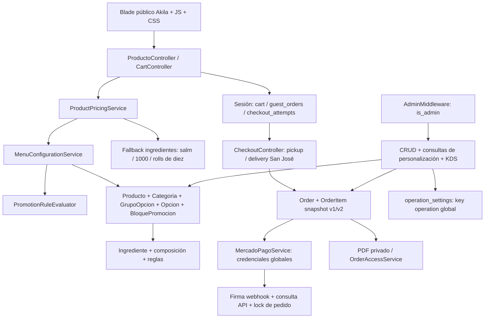
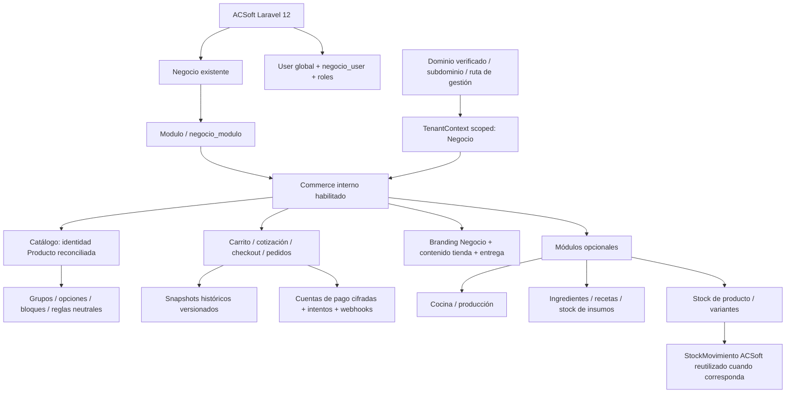

# Auditoría de generalización: Sushi Akila → ACSoft Commerce

Fecha: 26 de octubre de 2026. **Solo auditoría del working tree actual** de `D:\akila` y lectura de fuentes de `D:\xampp\htdocs\acsoft`. No es una migración ni una aprobación de producción. Los cambios funcionales que ya estaban presentes al comenzar se preservan.

Documentos complementarios:

- [Matriz de componentes e inventario](acsoft-commerce-component-matrix.md).
- [Matriz de las 26 tablas y tenancy](acsoft-commerce-tenancy-matrix.md).
- [Roadmap con criterios de terminado](acsoft-commerce-roadmap.md).

## 1. Dictamen y decisión principal

**Conviene generalizar primero el núcleo comercial en el proyecto Akila y luego integrarlo como módulo interno de ACSoft, siguiendo desde el principio los contratos existentes de ACSoft.** No conviene trasladar primero todo su código y generalizar dentro del sistema principal. Tampoco conviene construir otro SaaS de tenancy independiente antes de integrar.

Motivos comprobados:

1. Akila ya concentra cotización de servidor, configuración relacional, carrito, checkout, verificación de Mercado Pago, PDFs privados y snapshots. Se pueden conservar sus contratos mientras se retira la semántica culinaria obligatoria.
2. ACSoft ya tiene `Negocio`, `negocio_user`, `Modulo`, `negocio_modulo`, autorización por membresía y branding editable. Duplicarlos como StoreTenant/BrandSettings independientes crearía trabajo incompatible.
3. **Ambos proyectos tienen `App\Models\Producto` y tabla `productos`, con contratos distintos.** Akila: `precio`, `categoria_id`, `personalizable`, bloques y opciones. ACSoft: `negocio_id`, `codigo`, `unidad`, `precio_venta`, `stock_minimo`, `StockMovimiento`, compras y ventas. Copiar archivos o ejecutar las migraciones de Akila sobre ACSoft colisionaría con el catálogo y sus FKs.
4. Akila usa `User.is_admin`; ACSoft usa `User.is_superadmin` y `negocio_user.rol/activo`. Importar primero sus rutas `admin.*` y autenticación ampliaría privilegios accidentalmente.
5. Generalizar primero no significa terminar una plataforma multi-tenant paralela: las primeras fases fijan el contrato con `Negocio`; el aislamiento y su validación se realizan en un entorno de integración antes de permitir dos negocios.

Estimación de trabajo **aprovechable**, no de funcionalidad SaaS terminada: **60–75%** global, con confianza media. No es una media ponderada de líneas ni una estimación de días. La mayor fortaleza es el contrato de configuración/precio/snapshot; el mayor bloqueo funcional es la falta de escritura administrativa de grupos/opciones/reglas. El bloqueo de integración es identidad de catálogo + aislamiento + pagos por cuenta.

## 2. Evidencia, documentación y límites

Se listó `docs/` recursivamente antes de inspeccionar implementación. Documentación técnica consultada: `auth-stabilization.md`, `commerce-security.md`, `database-audit-sushi-akila.md`, `menu-database-architecture.md`, `menu-import-batches.md`, `menu-commercial-integration.md`, `menu-final-audit.md`, `menu-ui-redesign.md`, `ui-reference/README.md`, `ui-reference/CODEX_PROMPT.txt` y comparador HTML. Los informes largos contienen inventarios de datos y reglas; sus conclusiones se contrastaron con modelos, servicios, migraciones y esquema real. No se consideran sus instrucciones históricas autorización para implementar ahora.

No existen `docs/admin-2-redesign.md` ni `docs/product-ai-images.md`. Sí existen referencias PNG del admin y tienda y capturas de verificación. No se realizó una nueva aceptación visual ni un recorrido de navegador en esta auditoría. La existencia de imágenes de productos en storage no se confunde con el estado antiguo documentado de cero fotos.

La documentación inicial de base de datos describe 18 tablas y catálogo vacío; **ya no es el estado actual**. Lectura actual mediante `SHOW TABLES`, `SHOW CREATE TABLE` y SELECT en transacción READ ONLY: **26 tablas, 46 migraciones registradas, 37 productos, 7 categorías, 23 ingredientes, 29 grupos, 115 opciones, 130 bloques, 479 reglas, 26 promociones, 3 pedidos y 5 líneas históricas**. No se imprimen clientes, credenciales ni payloads de sesión. Se conservaron hashes, no copias de datos personales, para comparación final.

ACSoft se inspeccionó por archivos exclusivamente: modelos, middleware, rutas, migraciones, controladores de catálogo/ventas/personalización, seeders de módulos y tests de aislamiento. No se arrancó su aplicación, no se conectó a su BD, no se ejecutaron tests allí. Su esquema se conoce por migraciones, no por certificación de su esquema desplegado. No se encontró AGENTS.md aplicable en las rutas comprobadas.

## 3. Arquitecturas

### Actual

### Objetivo, reutilizando ACSoft

## 4. Clasificación A–F y componentes valiosos

Clasificación obligatoria: A reutilizable sin cambios; B reutilizable con cambios menores; C acoplado y debe generalizarse; D exclusivo/configuración o módulo; E legacy/deuda a retirar después; F decisión pendiente. El inventario complementario asigna una categoría a cada archivo fuente y conserva rutas reales. B se refiere a semántica comercial: aun B exige revisar tenancy antes de compartir datos.

| Componente | Clase | Dictamen concreto |
|---|---|---|
| MenuMoney | A | BigDecimal y centavos, no conoce sushi. Mantener; el nombre no bloquea reutilización. |
| GrupoOpcion/Opcion/AsignacionGrupo | B | CORE valioso: single/multiple, cardinalidad global/local, ingrediente opcional, recargo decimal, estado y orden. Añadir administración y aislamiento. |
| Categoria, Order, OrderItem | B | Clasificación, pedido e historia reutilizables; tenancy y entrega requieren adaptación. |
| OrderItemSnapshotService | B | Contrato genérico con versión, producto, cantidades, importes, configuración, selecciones y cargos. CLP es alcance inicial válido. |
| ProductPricingService | C | Entrada unificada y revalidación excelentes; fallback por proteína/vegetal/salm y tarifa 1000 debe quedar en compatibilidad Sushi. |
| MenuConfigurationService | C | Bloques y grupos reutilizables; aún clasifica por slugs, exige suma de unidades y produce preparación/salsas/base. |
| PromotionRuleEvaluator | C | Restricciones por IDs y recargos útiles; rol filling depende de slug y tipos/metadata culinarios. |
| Producto/BloquePromocion/UnidadComercial | C | Identidad/bloques se conservan; separar cantidad comprada, incluida y etiquetas. No reconstruir relaciones. |
| Ingrediente/IngredienteProducto/IngredientImpact | D | Módulo gastronómico opcional; retail no debe necesitarlos. |
| KitchenWorkflow/KitchenMetrics y vistas kitchen | D | KDS opcional. Workflow tiene locks útiles; métricas Sushi cuentan piezas/frito/frío por texto. |
| Promocion/promocion_handroll | E | Complemento legacy con precio duplicado y cantidad_rolls. Conservar lectura/IDs; evaluar deprecación tras mapa de consumidores. |
| Batch01–05/importador/MenuIdentity | D | Template/demo Sushi versionado e idempotente; nunca seed obligatorio del Core. |
| User y catálogo compartido ACSoft | F | Resolver identidad, perfiles y colisión Producto antes de trasladar. |

No hay clases propias Policies, Jobs, Events, Listeners o Notifications. Existen eventos del framework para registro/reset/lockout. No hay entidades Cart, Payment, Recipe, Variant ni ledger de inventario en Akila. `admin.inventory` es vista informativa, no inventario funcional.

## 5. Hardcoding: conteo y significado

La matriz incluye patrones, archivo y **todos los números de línea** encontrados. Se contaron fuentes PHP/Blade/JS/CSS/config/seeders/tests/docs previos; se excluyen vendor, node_modules, compilados e informes de esta auditoría. Los patrones se solapan: no sumarlos como vulnerabilidades.

| Búsqueda | Líneas coincidentes | Ocurrencias | Archivos |
|---|---:|---:|---:|
| Marca/localidad/contacto literal | 1084 | 1426 | 74 |
| Logo/favicon/contacto/delivery/promoción | 484 | 630 | 68 |
| Conceptos sushi | 1641 | 3752 | 77 |
| Colores hexadecimales | 143 | 336 | 8 |

De marca literal, **659 líneas/911 coincidencias en 41 archivos** son runtime/esquema/herramientas, muchas por clases `akila-*`; 36 líneas son seeders, 188 tests y 201 documentación. Conceptos sushi: 182 líneas runtime/esquema/herramientas, 222 seeders, 279 tests y 958 docs. Esto es un censo léxico reproducible, **no 1084 reglas funcionales defectuosas**. La búsqueda por términos castellanos se complementó con `cream_cheese`, `scallions`, `pieces`, `cantidad_piezas`, `rolls_*`, slugs, tarifas y lecturas de servicios. Un límite por ID cargado en BatchData es dato válido; `str_contains(nombre,'salm')` en pricing sí es hardcoding funcional.

Se identifican **20 focos prioritarios de acoplamiento** en la sección TOP 20; cada foco puede contener numerosas apariciones. No se declara un número exacto de “decisiones de negocio hardcodeadas” a partir de regex. Teléfono/dirección/SEO son datos de negocio incrustados en plantillas; las clases CSS con marca son nomenclatura, no necesariamente lógica. El branding público debe parametrizarse; los datos demo deben conservarse como template.

Hallazgos funcionales principales: límite por texto salm y +1000 en fallback; conversión múltiplos de diez; roles de grupo por slug; `sabor-*` produce mixto; `salsa_incluida`/`preparacion_global` activan detalle específico; enum pieza→Roll; cantidad de bloques ligada a cantidad incluida; delivery dentro/fuera de San José; descriptor de cobro Sushi Akila; singleton de operación.

## 6. Producto, unidades, bloques, opciones y variantes

`Producto` ya es la única identidad vendible. `TipoProducto` contiene simple/promocion/combo, sin tipo sushi/hamburguesa por familia: conservar. Categorías pueden contener nombres de cualquier rubro. No se necesita tabla Hamburguesa/Pizza/Café.

| Caso | Capacidad actual | Brecha |
|---|---|---|
| Hamburguesa/pizza/café personalizable | Grupos a nivel producto, opciones sin ingrediente, recargos y múltiples grupos | CRUD de configuración ausente; etiquetas/roles culinarios y bloques heterogéneos |
| Bebida/figura/polera simple | Precio + categoría + imagen + cantidad; sin relaciones obligatorias a ingredientes | Ruta de cotización vacía cae a contrato legacy; neutralizar UI/default pieza |
| Un grupo | single min=max=1 existente | Habilitar escritura/activación administrativa segura |
| Múltiples grupos/extras | multiple y min/max; recargo por cada opción | No hay cantidad repetible por opción ni tarifa distinta por asignación |
| Talla/color | Opciones sin ingrediente pueden expresar elección | No son variantes SKU: falta stock/precio/imagen por combinación |
| Venta por unidad/cantidad entera | Carrito 1–50 y hasta 100 configuraciones | Cantidad fraccionaria/kg no soportada; no prometerla |
| Servicio genérico sin agenda | Podría vender una línea simple con retiro/entrega adaptados | Reserva/agenda fuera de alcance inicial |

Una figura de $19.990, sin ingredientes/grupos/bloques, **no requiere conceptualmente nuevas tablas de personalización**. Por lectura, ProductPricingService puede cotizarla con defaults vacíos, sin recargo; no exige ingrediente al guardar. Pero entra a fallback v1 que consulta Ingrediente::all y genera “Sin base”, proteínas/vegetales vacíos. No se ejecutó una compra persistente para demostrar retail. Debe tener camino simple neutral explícito y feature test sin filas ingredientes antes de afirmar soporte perfecto. El formulario actual crea borrador, fija personalizable=false y no proporciona creación posterior de grupos. Además `productos.descripcion` es NOT NULL real mientras el request permite nullable: corregir coherencia de alta vacía antes del onboarding.

### Unidades y piezas

`productos.unidades` = contenido incluido; `cart.unidades`/`order_items.unidades` = cantidad comprada. La distinción es correcta y no debe perderse con un renombre cosmético. Existe `unidad_tipo` (pieza, hand_roll, unidad), y bloques ya tienen `cantidad_unidades` además de `cantidad_piezas` nullable. No proponer agregar otra cantidad_piezas al producto.

El acoplamiento real está en default pieza, `UnidadComercial::blockLabel()` que devuelve Roll, `rolls_total/rolls_fritos/rolls_envueltos`, normalización legacy por diez y contrato `pieces`/preparaciones. Evolución: unidad comercial y etiqueta configurables, bloques con cantidad/tipo explícitos; dejar los campos actuales como compatibilidad versionada. `quantity`, `included_quantity`, unidad física y servings no son sinónimos. No convertir piezas a gramos/stock, ni esconder toda semántica en metadata.

### Bloques de promoción

`bloques_promocion.producto_id` pertenece a Producto, **no exige Promocion**; tiene nombre, orden y asignaciones independientes de grupos. Es infraestructura de configuración de componentes que merece conservarse.

Sushi Roll1/2/3 ya funciona; combo principal/acompañamiento/bebida necesita permitir unidades y etiquetas heterogéneas. Hoy `quote()` exige `block.unidad_tipo === product.unidad_tipo` y que suma de cantidades de bloques sea `producto.unidades`: esto **sí bloquea** un combo hamburguesa+bebida o pizza en mitades cuando el contenido no es una suma de piezas homogéneas. No reconstruir bloques: hacer esa invariante una política de presentación aplicable al template Sushi y modelar explícitamente cantidad/rol de componente para otros combos. Elegir bebida como opción no equivale todavía a enlazar producto componente con stock propio.

### Grupos y opciones

Proteína, Queso, Tamaño, Color, Talla, Tipo de leche, Extras y Bebida caben en GrupoOpcion/Opcion. `ingrediente_id` nullable permite opciones comerciales puras: ya lo demuestra Arrollados (Primavera/Jamón Queso sin ingredientes).

| Requisito | Estado real |
|---|---|
| Valor/nombre | nombre/slug; falta código técnico separado solo si integración lo necesita |
| Recargo | DECIMAL(10,2), validación no negativo, suma en servidor |
| Disponibilidad | activo en grupo/opción; ingrediente.is_available si aplica; no es stock |
| Límites | min/max en grupo y overrides en pivotes; obligatorio nullable |
| Única/múltiple | single/multiple; IDs distintos, no cantidades por opción |
| Orden | opción/grupo/pivote; cotización ordena IDs para canonicidad |
| Activación | Existe a nivel datos; UI completa para administrarla no existe |
| Variantes/SKU | No hay combinaciones, SKU ni inventario por variante |
| Disponibilidad/recargo por producto | Grupos compartidos; overrides solo cardinalidad, no recargo de opción por asignación |

### Reglas

`max_repeticiones`, `excluir`, `recargo`, `min_piezas`, `cantidad_incluida`; sujeto ingrediente **o** opción, valor y metadata. Max 2 extras y exactamente 1 tamaño, entre 1 y 3 ingredientes se expresan mejor con cardinalidad de grupos. Gouda +500 usa Opcion.recargo directamente, sin regla nueva.

No existe regla general X incompatible con Y. `excluir` prohíbe un sujeto siempre, no condicionadamente a otro. No existe mecanismo general “primeras N unidades de opción incluidas, resto pagadas”: cantidad_incluida se interpreta en helpers para salsas/preparaciones y no es descuento universal. `isFilling()` reconoce envoltura/preparacion/salsas-adicionales/sabor-* por slug; condición de recargo se elige entre modificación relleno/envoltura. Para nuevas reglas usar tipos cerrados, ámbito explícito y validación; no construir DSL arbitrario ni ejecutar fórmulas JSON.

### Ingredientes, recetas y promociones

Ingrediente debe sobrevivir como **módulo opcional** para restaurantes/costos/recetas, no como condición del catálogo. La opción puede apuntar al ingrediente cuando existe. Un café con leche puede vincular selección comercial a consumo físico; una talla S no necesita ingrediente ficticio.

`ingrediente_producto.cantidad/unidad` son preparación útil para receta, pero no hay Recipe, versión, rendimiento, conversiones, ledger o reserva. Futuro opcional: Producto → Recipe versionada → Components con ingrediente/insumo, cantidad/unidad; opciones ajustan receta efectiva versionada. No reinterpretar cantidad_permitida como receta. Stock retail usa productos/SKU; stock restaurante usa insumos en kg/ml y movimientos. Reutilizar StockMovimiento ACSoft para identidad de stock acordada antes de introducir otro ledger.

Promocion es complemento 1:1 nullable de Producto; contiene nombre/descripcion/precio/cantidad_rolls/categoria duplicados y componentes en promocion_handroll. Bloques/reglas no dependen de ella. Mantener por compatibilidad e importación; vender siempre Producto.precio. No convertirla automáticamente en motor de campañas/descuentos. Evaluar deprecación del duplicado tras resolver consumidores/importador; no fusionar ni eliminar ahora.

## 7. Carrito, precio, historia y checkout

Carrito en sesión, sin tablas cart/cart_items. `CartController::quote/add/update` y checkout usan ProductPricingService; soporta producto básico, grupos de producto, bloques, extras por recargo y cantidad entera. Hash canónico usa producto/configuración; misma configuración fusiona cantidad, distinta conserva línea. No cobra precio enviado por navegador. Checkout revalida y pide revisión si cambió precio.

Precio nuevo: base + suma de opciones/reglas por presentación, multiplicado por cantidad; delivery se suma al pedido. MenuMoney es exacto; aún hay floats al devolver cotización, sumar checkout y serializar snapshots/payload SDK. Mantener CLP inicialmente es razonable; no incluir multicurrency en el primer alcance. Futura política común exacta debe mantener mismos importes históricos y convertir solo en borde SDK, sin recálculos retroactivos.

Fallback tiene contrato envoltura_id/Proteínas/vegetales/cream_cheese/scallions, salm por nombre, máximos y +1000; encapsularlo para catálogo/historia legacy. No basta renombrar ProductPricingService.

`OrderItemSnapshotService` produce v1/v2 con product id/name/description/slug/unit_type/included_quantity; quantity; base/surcharge/final/line_total; configuration; selections y charges. **Es CORE prioritario**. El detalle culinario viaja como payload, no obliga a reconstruir todas las selecciones para otros rubros. Futuro snapshot v3 puede agregar negocio, unidad neutral, variante y reglas versionadas; conservar lectores v1/v2.

`OrderItem::updating` impide sustituir snapshot existente. No es inmutabilidad SQL ni protege todas las columnas históricas frente a query builder/SQL. Es requisito futuro proteger nombre/cantidad/importes y limitar permisos de escritura de historia; ajustes mediante registros compensatorios, no sobrescritura. FKs reales producto→líneas y categoría→productos impiden borrado de catálogo comprado. Order→items aún CASCADE: controlar cualquier borrado de pedidos.

Checkout CORE: cliente/contacto/dirección/comentarios, método de entrega, subtotal, costo, total, creación transaccional de pedido/líneas y acceso invitado/propietario. Específico: zonas dentro/fuera, mensaje San José, tarifa config global, pickup/delivery exclusivos, integración MP única y estados culinarios. No hay método de pago seleccionable genérico.

`OperationSettings` persiste abierto/online_orders/delivery_enabled/horarios, **pero son informativos**: la vista lo declara y checkout no consulta esos flags. No prometer que cerrar la tienda impide pedidos. Conectar estas reglas en servidor, definir zona horaria, horarios nocturnos, excepciones y fallback seguro por negocio.

## 8. Entrega, pagos y webhooks

`config/delivery.php`: locality San José, local_price=2500, outside_price=null, outside_status=pending_manual_quote. `CheckoutController::calculateDeliveryCost` bloquea fuera antes de crear pedido/preferencia. Blade checkout repite $2.500 y localidad; PDF también presenta dentro/fuera de San José. No hay geovalidación de que dirección realmente pertenezca a zona. El cliente declara zona: no confundir tarifa configurable con validación geográfica.

Futuro por negocio: pickup habilitado, dirección de retiro; delivery por zona/tarifa fija/gratis desde umbral; envío nacional como modo opcional; no disponible; cotización manual sin iniciar cobro de total incompleto. Guardar modo/zona/nombre/tarifa y política aplicada en snapshot del pedido. No exigir mapas ni distancia automática al MVP.

### Estado de pago actual

Credenciales y secreto de webhook vienen de `config/services.php`/entorno. MercadoPagoService configura **estáticamente** MercadoPagoConfig::setAccessToken antes de consultar/crear; descriptor es Sushi Akila; moneda CLP; external_reference=orders.id. Preferencias viven en sesión hasta un día. PaymentService consulta proveedor, verifica ID/referencia/monto/moneda/fecha y bloquea fila; evita degradación/repetición. Firma HMAC valida timestamp y body/query ID. Retorno de navegador no aprueba pago por sí solo. Conservar todo eso.

Brechas para varios negocios: cuenta receptora no forma parte del pedido; no hay credenciales tenant, payment account, historial durable de intentos ni idempotencia entre dispositivos. No hay prueba de collector/account receptor en datos normalizados devueltos por getPayment. SDK con estado estático requiere especial cuidado en workers persistentes/concurrencia; un singleton mutable de token puede mezclar cuentas.

### Diseño seguro recomendado, sin implementación

Cuenta de pago pertenece a Negocio y tiene proveedor/ambiente/identificador receptor/estado y credenciales **cifradas mediante mecanismos Laravel**, ocultas en serialización/logs y con acceso restringido. Claves de infraestructura en servidor/gestor de secretos, rotación y recuperación documentadas. Validar longitud de columna para cast encrypted y no indexar valores cifrados. Nunca guardar secretos legibles en configuracion JSON pública ni devolverlos al frontend. Confirmar más adelante modelo comercial de conexión/OAuth con Mercado Pago antes de elegir credenciales manuales como producto definitivo.

Persistir intento con negocio_id, order_id, payment_account_id, referencia opaca única, preference/payment IDs, importe/moneda y clave idempotente. El pedido queda vinculado a cuenta/ambiente **del momento de cobro**, no a la cuenta actualmente elegida por el negocio. No recalcular historia ni cambiar receptor en un reintento existente.

Webhook futuro: endpoint identifica cuenta candidata mediante identificador opaco del endpoint o registro de integración, no por negocio_id confiado del body; validar firma con secreto correspondiente; consultar proveedor con credenciales de esa cuenta; resolver intento por referencia persistida y validar negocio/pedido/cuenta/receptor/ambiente/monto/moneda. Solo entonces transacción+lock e idempotencia. Un callback autenticado de B con external_reference del pedido A debe rechazarse aunque los montos coincidan. Si secreto es por aplicación compartida, la estrategia exacta cambia: documentar relación aplicación/cuenta y no intentar tokens de todos los negocios. Referencia es localizador, jamás autorización.

No cambiar ahora external_reference histórica numérica: mantener resolución legacy explícita y acotada a cuenta Sushi. Un tenant_hint/dominio no es prueba. Enlaces firmados deben incorporar negocio y validar el host canónico y ownership; invalidar una firma válida de otro negocio. La rotación de APP_KEY puede invalidar enlaces/documentos y afectar descifrado: no hacerla al integrar sin plan.

## 9. Frontend, theme, contenido y rutas

Layouts/cards/forms/precio/modal/carrito ya ofrecen estructura adaptable reutilizable. Branding está en home, layouts, header/footer, catálogo fallback y admin. SEO actual: título “Sushi artesanal en Mariquina”, sufijo Sushi Akila y favicon fijo. Hero usa slide1sushi.png/slide3.jpg y textos de sushi. Footer tiene dirección Fernando Luis Manss 542 y teléfono repetidos. Revisar también `layouts/legacy-public.blade.php` y autenticación/perfil: no basta sustituir el home.

`resources/css/custom.css` ya tiene variables --akila-black/red/orange/cream, pero muchas reglas posteriores tienen hex literales. `resources/css/admin.css` también tiene paleta fija. Estrategia: mapear primero tokens semánticos --brand-primary/secondary/accent/background/text y estados de error/éxito separados; dar defaults neutrales y usar CSS variables por negocio. No renombrar todas las clases akila por estética. Validar colores con formato limitado/contraste, sin aceptar CSS arbitrario.

| Setting | Destino | Motivo |
|---|---|---|
| store_name | Negocio.nombre existente | Una identidad de negocio; nombre comercial opcional si difiere |
| logo, primary_color, secondary_color | Campos Negocio existentes | ACSoft ya tiene CRUD y contraste/validación |
| favicon, accent_color, background | Extensión tienda vinculada a Negocio | Editables; paths/valores validados |
| typography | Clave de preset permitido | DB solo si el dueño puede elegir; archivos/font stack en assets/config |
| hero título/subtítulo/imagen/CTA | Settings estructurados tienda | Contenido editable; no Blade ni CSS desde DB |
| footer/contacto/redes/SEO | Settings estructurados | Validar URLs/esquemas y escapar contenido |
| márgenes/breakpoints/layout de formularios | Código/theme preset | No necesita filas DB por cada propiedad CSS |
| estados vacíos/mensajes de validación | Traducciones Core | No exigir editar contenido estructural en cada tenant |

ENV/server: DB credentials, encryption keys, mail/queue/storage infrastructure, plataforma/domino raíz, claves de servicio de infraestructura. DB/negocio: nombre, colores, horarios, tienda abierta, textos, tarifas, métodos habilitados. Credenciales proveedor por negocio: almacenamiento cifrado restringido. No usar `.env` como panel del dueño ni mutar config global durante requests.

`/menu` es ruta de catálogo, no un defecto arquitectónico. Conservarla para restaurantes; ofrecer `/catalogo` o alias configurado y acotado más adelante con canonical/redirects. No permitir arbitrariedad que colisione con checkout/auth. `section=promociones` aparece en enlaces, pero ProductoController solo aplica filter/q/sort: deuda de navegación, no motor de promoción activo.

PDF `resources/views/pdf/invoice.blade.php` no contiene un logo/nombre Sushi universal en cabecera; sí localidad en entrega y resumen compartido culinario. La comanda `admin/orders/print.blade.php` sí tiene Sushi Akila. Parametrizar emisor/dirección/logo futuros por snapshot de negocio y preservar PDFs ya emitidos; no regenerarlos con branding actual como si fuera histórico.

Mail/notificaciones: no hay Mail/Notification propia en Akila; reset usa framework y config/mail global. Futuro nombre/remitente/plantilla por negocio cuando es comercial; autenticación de identidad global conserva branding plataforma acordado. No permitir From arbitrario sin dominio verificado.

## 10. Administración, clientes y módulos

El working tree **ya incluye rediseño operativo**, OperationsController, AdminChange y KDS; no ejecutar otro prompt Admin 2.0. Estado actual:

- CRUD categorías/productos y carga imagen; duplicación conserva grupos compartidos y copia bloques/reglas, todo como borrador.
- Editor muestra configuración, pero no permite construir grupos/opciones/bloques/reglas. `/admin/personalization` es consulta declarada de solo lectura.
- Settings persiste operación/horarios, no branding/pagos/zonas ni comportamiento público.
- Clientes: OperationsController consulta User::whereHas('orders'); excluye guests y agrega todo sin negocio.
- Roles: solo is_admin. No owner/manager/staff separados ni policies por recurso.

Menú futuro Core: Resumen, Pedidos, Catálogo (Productos, Categorías, Opciones), Clientes, Reportes, Configuración. Opcionales: Cocina, Ingredientes, Inventario, Recetas, Delivery, Producción. Reutilizar componentes admin/pagination/badge/icon y separar alertas de cocina del layout obligatorio.

Módulos propuestos: commerce.catalog/cart/checkout/payments/reports, con delivery/kitchen/ingredients/inventory/recipes/production opcionales. Reutilizar Modulo/negocio_modulo como habilitación Commerce y configuración de capacidades validadas; no crear otro catálogo de permisos paralelo. Ocultar menú no es autorización: rutas/servicios verifican módulo habilitado. Mantener claves técnicas estables, labels traducibles/configurables por industria.

Clientes no deben ser negocio_user automáticamente. `User` = identidad autenticada global propuesta; `negocio_user` = membresía administrativa; perfil cliente Commerce = relación tenant con datos/consentimiento comercial; `Order` conserva snapshot de comprador guest o registrado. ACSoft.Cliente representa cliente de la plataforma **dueño de negocios**, no comprador de hamburguesas: no reutilizarlo indiscriminadamente como customer de tienda.

Mapeo roles futuro: SUPERADMIN→ACSoft.is_superadmin; BUSINESS OWNER→definición pendiente en membresía/propiedad; MANAGER/ADMIN→rol admin actual como base; STAFF→usuario con capacidades restringidas; CUSTOMER→perfil/compras, sin membresía de gestión. No elevar is_admin Akila a superadmin automáticamente al importar.

## 11. ACSoft real e integración

Archivos clave inspeccionados en `D:\xampp\htdocs\acsoft`:

| Ruta | Evidencia |
|---|---|
| app/Models/Negocio.php | nombre/slug/subdominio/dominio_personalizado, logo/colores/configuracion; usuarios/módulos; route key slug |
| app/Models/User.php | is_superadmin, negocios, canManageBusiness y selección dashboard |
| app/Models/Modulo.php; database/seeders/ModuloSeeder.php | Catálogo analítica/ventas/gastos/caja/productos/stock/compras/reportes y asignación por negocio |
| middleware EnsureUserCanAccessBusiness/EnsureUserHasBusinessRole/EnsureBusinessHasModule | Negocio activo, membresía activa, rol y módulo |
| routes/web.php; bootstrap/app.php | Gestión /gestion/{negocio}, alias tenant.business/business.role/module/superadmin |
| Gestion/PersonalizacionController.php | Logo, dos colores; validación segura, prefijo business-logos/{id} |
| Gestion/ProductoController.php | Queries desde negocio, unique por negocio y ownership explícito en edit/update/destroy |
| Gestion/VentaController.php | Rule::exists con negocio_id, transacción, producto/stock y comprobante con ownership |
| app/Models/Producto.php; StockMovimiento.php | Catálogo/stock propio ya consumido por ventas/compras |
| tests/Feature/TenantIsolationTest.php y BusinessRoleAuthorizationTest.php | Pruebas de membresía/roles; no cubren todavía Commerce |

ACSoft resuelve gestión mediante **ruta**, no se encontró resolver de tienda pública por host ni TenantContext global. Tener columnas subdominio/dominio no prueba DNS/TLS/validación operativos. El patrón observado usa relaciones/ownership explícitos; no asumir global scope mágico. `Negocio.cliente_id` tiene CASCADE desde Cliente: revisar baja/retención antes de colgar historial Commerce de una cadena que pueda borrarlo.

| Integración | Complejidad/mantenimiento | Seguridad/deploy/hosting | Dictamen |
|---|---|---|---|
| A Copiar archivos | Aparente facilidad, colisiones modelos/tablas/rutas/auth | Puede romper ventas existentes; migraciones incompatibles | Rechazar copia directa |
| B Módulo interno | Adaptación inicial moderada, un ciclo de Laravel/deploy | Reutiliza auth/Negocio/módulos/stock; bajo costo hosting | **Recomendado** |
| C Package Composer privado | Versionado/provider/views/migrations y API pública de extensión | Mismo proceso; no resuelve aislamiento por sí mismo | Evaluar al tener segundo consumidor estable |
| D Servicio/API separado | Autenticación servicio, contratos, duplicación/latencia/operación | Dos despliegues, secretos y consistencia distribuida | Coste innecesario para objetivo PYME |
| E Separados con auth compartida | SSO y sincronización de negocios/productos/permisos | Cookies entre dominios/refresh/revocación; dos hosts | Solo transición acotada si despliegue lo exige |

Catálogo recomendado: una identidad Producto ACSoft cuando se pueda demostrar compatibilidad; extensión 1:1 Commerce con campos de publicación/personalización y relaciones correspondientes. Alternativa transitoria: tablas y namespace de catálogo Commerce explícitos con mapeo al Producto de gestión; requiere decidir autoridad de precio/stock y reconciliación, no dos catálogos silenciosamente editables. No elegir mecánicamente “fusionar modelos”: realizar prueba de esquema y flujos venta/compra/stock en integración. La decisión de identidad es fase G1 y bloquea importación.

IDs: conservar IDs Akila en su origen; dentro de tabla destino con filas existentes no se puede garantizar conservar el mismo entero. Si se integra como extensión sobre productos existentes, mapa `(source,tabla,legacy_id)→id_destino` para FKs, referencias externas y archivos. Si tablas separadas no colisionan, pueden preservarse enteros bajo namespace explícito. No renumerar pedidos ya referenciados por MP sin resolver referencias legacy. UUID/ULID son útiles para referencias públicas/intentos, **no sustituyen autorización** ni obligan a cambiar todas las PK.

## 12. Tenancy, contexto y dominios

| Opción | Seguridad/backup/consultas | Mantenimiento/escala/pagos/archivos | Dictamen |
|---|---|---|---|
| Shared DB + negocio_id | Aislamiento aplicativo + FK compuesta; backups comunes y restore por tenant más trabajado | Reutiliza ACSoft, consultas simples, un esquema/deploy; namespace de cuenta/storage obligatorio | **Recomendada para PYME actual** |
| DB por negocio | Mejor separación operacional; backup/restore tenant más directo | Provisioning, pools/credenciales, migraciones N veces y reportes cruzados complejos | Reservar a exigencia contractual/operativa |
| Híbrido esquema/DB | Control plane común y datos separados | Más modos de backup/deploy/conexión; MariaDB no equivale a schemas aislados de PostgreSQL | No implementar en MVP |

No instalar stancl/spatie todavía. Laravel nativo, relaciones explícitas/policies y un contexto pequeño bastan para validar el alcance; paquete se reevalúa si provisioning de múltiples DB/domains lo justifica. ACSoft ya usa negocio_id: usar ese nombre.

### Resolución segura

1. Host normalizado contra lista de dominios **verificados, únicos y activos**, con proxies/hosts confiables configurados. Dominio desconocido falla, jamás cae a Sushi o “primer negocio”.
2. Subdominio exacto bajo dominio raíz permitido resuelve Negocio activo con Commerce habilitado. Registrar rutas domain antes de raíz.
3. Gestión en dominio administrativo de plataforma: `/gestion/{negocio}/commerce`, resolver slug + membresía + rol + módulo. Sesión puede recordar selección solo como comodidad; la ruta y autorización mandan.
4. Superadmin: ruta explícita y autorización de plataforma; no bypass implícito en tienda pública. Si host, ruta y selección discrepan, rechazar; no elegir el último valor.
5. Webhook usa resolución independiente de cuenta autenticada; no depende de sesión ni del middleware del comprador.

TenantContext representa Negocio resuelto, con binding scoped por request/job y fallo si falta contexto en operaciones comerciales. Resolver contexto antes de binding de Producto/Order; en rutas anidadas usar scopeBindings con relaciones correctamente nombradas o binding explícito por relación. Un `find(id)` global dentro del servicio sigue siendo peligroso aunque la ruta esté anidada. Policies combinan membresía/capacidad y pertenencia del recurso. Ningún global scope es única defensa: DB::table, joins, exports y imports requieren revisión explícita.

Dominios propios requieren prueba de propiedad, normalización, unicidad, estados pendiente/activo, certificado/TLS y baja segura. Laravel domain routing no configura DNS/Cloudflare ni prueba propiedad. No se modifica nada de infraestructura ahora.

### Storage

Actual: imágenes en productos/ y logos estáticos public/img; avatars/ global de identidad; PDF local privado boletas/boleta-{id}.pdf con fallback público histórico y comando PrivatizeInvoices. Objetivo lógico: `businesses/{negocio_id}/products/...`, `branding/...`, `documents/...` usando Filesystem. Los documentos permanecen en disco privado y descarga autorizada; prefijo no es ACL. No devolver storage keys de otros tenants ni aceptar rutas arbitrarias para borrar/copiar archivos.

Imágenes de catálogo **publicadas** son recursos públicos por diseño: un cliente puede ver URLs de otra tienda pública. El test “no usar imagen B” debe impedir adjuntarla/editarla/borrarla desde A y leer assets privados/no publicados; no prometer confidencialidad de imágenes que intencionalmente se sirven públicamente. Si se exige ocultar todo entre tenants, entrega autenticada/firmada por host y sin disco público, con costo adicional.

Respetar business-logos/{id} existente de ACSoft; no moverlo solo para homogeneizar una ruta propuesta. Adaptar Filesystem/DTO de branding. El fallback global public disk URL basado en APP_URL requiere host/CDN canónico seguro para tiendas con dominio propio.

## 13. Superficies concretas de aislamiento y seguridad

Los siguientes son riesgos **al compartir varios negocios**, no afirmaciones de explotación actual en una tienda única.

| Severidad | Ubicación/consulta | Fallo si solo se agrega negocio_id | Defensa necesaria |
|---|---|---|---|
| CRITICAL | AdminMiddleware y todas las rutas admin | is_admin A pasa para datos B | Membresía/rol/módulo y policy por recurso |
| CRITICAL | Admin/OrderController binding, selected query parameter, PDF/print/update | Leer cliente/PDF o cambiar pedido B | Binding y consultas por Negocio; autorización en descarga/transición |
| CRITICAL | CartController exists/find, refreshCart whereIn | Cotizar/comprar producto B, mezclar carrito | Exists + carga + contexto en línea/hash y sesión |
| CRITICAL | MercadoPagoPaymentService Order::find(reference) | Pago cuenta B asociado a A de igual monto | Intento y cuenta persistidos + receptor/negocio verificados |
| CRITICAL | OperationSettings DB::table key=operation | Configuración de A altera B | Clave compuesta y servicio con Negocio explícito |
| CRITICAL | OperationsController::customers | PII/compras de todos los usuarios | Perfil tenant, orders filtrados y aggregate filtrado |
| HIGH | ProductoController index/modal y Home Blade | Catálogo/imágenes no publicadas de B | Consultas disponibles dentro de negocio |
| HIGH | MenuConfigurationService missing Opcion/Ingrediente queries | Resolución de sujeto ajeno | Tenant + pertenencia/aplicabilidad |
| HIGH | GrupoOpcion DB::table pivotes / AsignacionGrupo::find | Overrides revisados/guardados entre negocios | Ambos extremos + FK compuesta |
| HIGH | Admin/ProductoController duplicate/lock/sync | Copia enlaza grupos/reglas B; lock global | Revalidar propietario dentro de transacción |
| HIGH | AdminChange polimórfico y history query | Auditoría revela cambios de B/secretos | negocio_id explícito, filtros y redacción |
| HIGH | IngredientImpact y dashboards/KDS/reports globales | Reportes/agotados/colas mezclados | Scope por negocio en todos los agregados y polling |
| HIGH | OrderInvoiceService path por ID/fallback | Colisión de archivos tras importar IDs | Namespace y mapa de documentos; acceso antes de generar |
| MEDIUM | MenuCardSummary y CSS/Blade | Contenido/labels inadecuados sin fuga crítica | Presenter/theme por unidad/módulo |
| LOW | Nombre MenuMoney y ruta /menu | No causan acceso cruzado | No renombrar por estética |

### Validación: inventario de reglas sensibles

- `Admin/ProductoController::data`: unique productos.slug e ignore(id), exists categorias.id → restringir Negocio y cargar modelo autorizado para ignore.
- `Admin/CategoriaController::data`: unique categorias.nombre → negocio; slug generado también necesita comprobación SQL por negocio.
- `Admin/IngredienteController::data`: unique ingredientes.nombre → negocio; definir índice si se conserva requisito de unicidad.
- `CartController::quote/add`: exists productos.id → negocio + disponible; repetir misma restricción al cargar.
- `ProfileController`, `ProfileUpdateRequest`, `RegisteredUserController`: unique users.email. Mantener global si identidad ACSoft global; no añadir scope tenant por costumbre.
- `AsignacionGrupo::saving`: find grupo global; `GrupoOpcion::saving` consulta ambos pivotes por grupo. Validar todos los extremos, incluso en importación.
- MenuConfigurationService verifica que blocks/options pertenezcan a producto/grupos, lo que es bueno; eso no valida que el catálogo original ya tenga owners coherentes.
- MercadoPagoController valida order/external_reference numéricos y luego busca global: no son unique/exists pero igualmente críticos.

### Cache, sesiones y procesos persistentes

No hay Cache::remember/keys comerciales propias encontradas. Sí throttles de rutas y RateLimiter de login (email+IP), infraestructura cache/locks y bloqueo de sesión en checkout. Si identidad es global, rate limiting login global sigue siendo apropiado; no dividir límites para permitir evasión por tiendas. Nuevas caches de catálogo/settings deben incluir negocio e invalidar solo ese namespace. Locks de pagos incluyen cuenta/pedido/tenant donde corresponda.

Sesión actual: cart, guest_orders, checkout_attempts.{fingerprint}, checkout_cart.{order}, checkout_preferences.{order}; fingerprints/hash no incluyen negocio. Futuro namespacing por negocio y líneas con owner; limpiar/seleccionar carrito al cambiar negocio sin perder otros carritos. Validar nuevamente guest access por tenant; una firma o sesión A no concede B. No compartir cookie de administración a todos los dominios de clientes.

No hay jobs propios ni Schedule actuales (routes/console solo inspire). Jobs futuros reciben negocio_id, order/account/attempt ID explícitos, revalidan owner en handle, se despachan tras commit y limpian contexto al finalizar/reintentar. No capturar request/sesión ni singleton mutable; no confiar únicamente en serialización Eloquent que restaura por ID. Scheduler itera negocios activos con módulo, abre contexto por iteración, locks por negocio, procesa zona horaria y registra fallos aislados. Cerrar tienda no necesita scheduler obligatorio si la disponibilidad se calcula al recibir checkout; tareas sirven para reportes/recordatorios/conciliación.

Eventos de pedido pagado se emiten una vez con IDs tenant después de persistencia y sus efectos deben ser idempotentes. Notificaciones/cola no deben reenviar secretos. Configuración dinámica no debe contaminar siguiente request/worker.

## 14. Negocio vacío, templates y datos históricos

Blank Commerce Tenant: Negocio activo + Commerce habilitado + settings seguros; **0 productos/categorías/opciones/pedidos**. Home/menu ya usan colecciones/forelse y enlaces de personalización con fallback; carrito vacío devuelve checkout a cart. Admin necesita tablas presentes y defaults de OperationSettings, no filas Sushi. No se ha certificado con un Feature Test de negocio vacío porque no existe Negocio en Akila.

Requisitos mínimos futuros: nombre/slug único, owner/membresía, branding default neutro, moneda CLP, zona horaria, entrega configurada, cuenta de pago válida antes de aceptar compra; tienda cerrada/no publicada por defecto hasta completar onboarding. Categoría es obligatoria al crear producto; nombre/descripción compatible con DB, precio válido y unidad comercial. No exigir ingredientes, logo real, hero ni demo para renderizar pantallas vacías.

No ejecutar `DatabaseSeeder`: crea categoría hand-roll y ProductoSeeder crea Hand Roll de Salmón. Tampoco ProductoSeeder, IngredienteProductoSeeder, principal SushiAkilaMenuSeeder ni Batch01–05 para blank. Permitir solo inicialización técnica/usuario/módulos revisada, separada de catálogo demo. Migraciones sí son necesarias en una instalación futura limpia, pero no se ejecutan ahora sobre BD persistente.

Templates futuros Restaurante/Sushi/Hamburguesería/Retail/Vacío aportan datos iniciales y settings. Batch01–05 son buena base de template Sushi con procedencia y claves naturales; MenuIdentity/importer hoy busca por slug/nombre global, así que deberá recibir negocio explícito y validar todos los sujetos. Versión de plantilla y registro de importación, preview y transacción; reejecutar no debe sobrescribir cambios del dueño sin política explícita. Desactivar demo no borra historia.

Para “dejar en blanco” una copia desechable: dependencias y tablas exactas están en matriz tenancy. **Para el producto real no borrar ni siquiera conceptualmente los pedidos Akila para habilitar otro negocio**: asignar filas actuales al tenant Sushi Akila, preservar los 3 pedidos/5 líneas, archivos y cuentas/referencias legacy. Blank es otro tenant. Categorías/productos históricos deben conservarse/archivarse por RESTRICT. Los datos de migraciones, identidades/membresías y configuración técnica no son catálogo a vaciar. No hay tabla de cart para truncar; son payloads de sesión específicos.

## 15. Prueba definitiva y casos de negocio

### Hamburguesas Pepe: 17 pasos

| Paso | Estado actual | Trabajo necesario |
|---|---|---|
| 1 instalación limpia | Migraciones y tests de estructura existen | Bootstrap sin seed demo, revisar coherencia MariaDB/SQLite |
| 2 crear negocio | Akila no tiene Negocio; ACSoft sí CRUD | Habilitar Commerce sobre Negocio existente |
| 3 logo | Akila estático; ACSoft CRUD seguro | Consumir Negocio.logo |
| 4 colores | CSS Akila; ACSoft dos colores | Tokens frontend conectados, defaults/acento |
| 5 categoría Hamburguesas | CRUD Categoria existe | Owner y unicidad por negocio |
| 6 producto Hamburguesa Doble | CRUD borrador existente | Camino simple/generic y descripción compatible |
| 7 grupo Tipo de carne | Modelo sí; UI no | CRUD grupo y asignación |
| 8 Vacuno/Pollo/Vegetariana | Opciones nullable ingrediente sí; UI no | CRUD opciones sin ingrediente obligatorio |
| 9 grupo Queso | Estructura sí; UI no | single 1..1, asignar producto |
| 10 Sin queso/Cheddar/Gouda +500 | Recargo ya suma servidor | Crear opciones y tarifa desde admin |
| 11 grupo Extras | Estructura sí; UI no | multiple 0..N configurable |
| 12 Tocino/Huevo/Palta recargos | Recargo genérico soportado | Escritura y límites administrables |
| 13 retiro | pickup implementado | Config por negocio/dirección/horario |
| 14 delivery | San José/2500 global | Zona/tarifa del negocio administrables |
| 15 pago | Solo MP global | Cuenta/método habilitado por negocio |
| 16 publicar | activo editable | Validación integral y personalizable derivado/configurado |
| 17 recibir pedido | Checkout/snapshot/pago existentes | Contexto completo y pruebas sin Sushi |

**Hoy no supera la prueba cero código**. Que se pueda construir con Eloquent/Seeder no equivale a onboarding administrativo. El trabajo más grande no es inventar modelos: es administración, neutralización de políticas y aislamiento coherente de flujos existentes.

### Tres casos concretos

| Caso | Reutiliza | Impide operar cero código | Opcionales no necesarios |
|---|---|---|---|
| Hamburguesería | Producto/Categoria; grupos carne/queso/extras; cart/orders/payments | Editor grupos/opciones, branding/entrega/pagos tenant; combos heterogéneos | Recetas/stock solo si se contratan; KDS útil opcional |
| Cafetería | Single tamaño/tipo leche; multiple extras; recargos | Mismas brechas; precio por tamaño puede ser recargo, SKU solo si stock distinto | Cocina Sushi, salsas/preparaciones, recetas si no usa costos |
| Tienda anime | Producto simple, precio/imagen, categoría, pedidos y pago | Camino simple neutral; envío nacional; stock retail integrado si lo necesita | Ingredientes, recetas, KDS, piezas/fritos, delivery restaurante |

Polera S/M/L/XL × Negro/Blanco puede representarse como opciones para cobrar; no como inventario de ocho variantes sin nueva entidad/combinación. No vender esa representación como SKU completo. Servicio sin agenda puede ser una línea; reservas/turnos, CRM avanzado y contabilidad completa permanecen fuera: módulos separados ACSoft.

## 16. Tests presentes y futuros

CORE reutilizable: CommerceSecurityTest (firma/verificación/importe/acceso/idempotencia/PDF), MenuArchitectureTest (estructura/FKs/cardinalidad/snapshots), auth/Profile con ajustes de identidad; partes de MenuCommercialIntegrationTest (hash, recargos, configuración ajena, checkout). Fixtures actuales de estas suites incluyen comida: conservar contratos y añadir fixtures neutros, no cambiar todas las aserciones para hacerlas pasar.

Sushi/template: SushiAkilaMenuBatch01–05Test, MenuFinalAuditTest, MenuUiRedesignTest, Support/MenuAuditConfiguration; AdminOperationsTest mezcla protección/locks genéricos con KDS/Sushi. Mantener suite demo separada de aceptación Core. ExampleTest es humo, no prueba de generalización. ACSoft ya tiene TenantIsolationTest/BusinessRoleAuthorizationTest/BusinessCustomizationTest: ampliar en integración sin asumir cobertura Commerce existente.

### BlankBusinessCommerceTest (diseño; no implementado)

En SQLite aislado y después MariaDB aislado: crear identidad autorizada/Negocio vacío mediante flujo normal ACSoft y habilitar Commerce; comprobar vacíos 200 sin ingredientes ni template. Subir logo y colores por endpoints normales. Crear categoría, borrador Hamburguesa Doble, grupos carne single 1..1, queso single 1..1 y extras multiple 0..2 mediante CRUD, con opciones/recargos del caso Pepe. Publicar con validación, cotizar (precio base + Gouda500 + Tocino1000), agregar cantidad2, verificar hash y total exactos, configurar retiro/delivery/método y checkout con gateway simulado. Persistir pedido/línea y snapshot; cambiar catálogo/branding y comprobar historia idéntica. Ninguna llamada directa a seed Sushi ni escritura de configuración de producto al margen de controllers/services normales. Solo preparación de identidad/infraestructura puede usar factories.

### CommerceTenantIsolationTest (diseño; no implementado)

Dataset simétrico A/B con mismos slugs y nombres, dos cuentas de pago y usuarios owner/staff/customer/guest; ejecutar cada ataque en ambas direcciones:

1. Host B con sesión/URL de A; host desconocido; conflicto host/ruta; dominio no verificado; módulo inactivo.
2. GET/PUT/PATCH/duplicate/publicar productos/pedidos de B desde A; selected query parameter; grupos/opciones/bloques/reglas cruzados.
3. quote/add/update con product B, option B dentro de producto A, block B, ingrediente B; cart/session pegada de B; checkout revalidado rechaza sin crear pedido/preferencia.
4. PDF/comanda/detalle del pedido B: admin A, customer A, guest A y firma B reutilizada bajo host A; también PDFs legacy y colisión de IDs migrados.
5. Clientes, reportes, KDS/polling/history sin filas ni conteos de B; verificar SQL agregado, no solo HTML oculto.
6. Upload/delete/attach con ruta de B, traversal, imagen privada/no publicada, logo de B; lectura pública legítima según política explícita.
7. Webhook B con referencia A y monto igual; firma inválida/válida de otra cuenta, receptor incorrecto, replays, simultaneidad y rotación; retorno no aprueba pago.
8. Worker A seguido por B en mismo proceso, cache/settings/token SDK sin contaminación, scheduler con fallos por negocio, locks/idempotencia por cuenta/pedido.
9. Relaciones cruzadas por query builder/SQL rechazadas por FK compuesta; falta contexto falla; staff sin capacidad de settings; user cliente nunca administrador.

Feature tests adicionales: opciones sin ingrediente, producto sin configuración, mixtos no culinarios, combo heterogéneo, variantes si se habilitan, horarios noche/cambio fecha/zona, fuera de cobertura, precisión monetaria/concurrencia, importación con remap de IDs y snapshot v1/v2 intacto. No usar tests de package para sustituir estos ataques.

## 17. Riesgos priorizados y deuda antes/después

**CRITICAL antes de dos tenants:** permisos is_admin global; consultas/bindings/validación sin owner; webhook/cuenta/referencia sin tenant; sesión/contexto singleton; mezcla de datos en relaciones; clientes/PDFs; colisión Producto/PK y cadena de borrado de Negocio/Cliente. Son bloqueantes de exposición multi-tenant, aunque la tienda única tenga controles de compra buenos.

**HIGH antes de integración:** CRUD configuración inexistente, reglas por slug/nombre; defaults y combos de piezas; operación informativa presentada como cierre efectivo; importadores globales; identidad customer/admin; namespace archivos; SDK estático; idempotencia solo sesión; descripcion nullable request contra NOT NULL; invariantes de snapshot incompletas fuera de Eloquent. Deben resolverse en fase correspondiente y medirse con tests.

**MEDIUM:** dispersión de colores/textos, importes con floats en bordes, queries repetidas de cotización, perfil sin paginación, slug cambia con nombre, categorías colisionan por normalización, precio de opción compartido entre productos, falta variantes/stock si el rubro lo requiere. **LOW:** nombres internos Menu*, prefijos CSS akila y URL /menu por sí solos.

Antes: contratos ACSoft/Producto/User, contexto y ownership, precio/checkout/pago, administración mínima, validación de publicación, historial y migración ensayada. Después: extracción package, renombres internos, eliminar legacy probado, optimización fina, recetas/producción avanzada, múltiples dominios por negocio y multicurrency si se aprueban. Variant/stock pasan de después a antes si el primer retail los necesita. No arrastrar afirmaciones antiguas de N+1/dashboard incorrecto: el DashboardController actual ya filtra ventas aprobadas y usa KitchenMetrics.

## 18. TOP 20 archivos con mayor acoplamiento

| # | Ruta | Motivo/evidencia | Riesgo | Acción futura |
|---:|---|---|---|---|
| 1 | app/Services/ProductPricingService.php | salm por nombre, +1000, múltiplos diez, catálogo global | CRITICAL | Camino simple neutral; adaptador legacy; contexto |
| 2 | app/Services/MenuConfigurationService.php | Slugs/mixto/salsas/preparación; suma y unidad igual | HIGH | Políticas de componentes y extensión culinaria |
| 3 | app/Services/PromotionRuleEvaluator.php | isFilling por slugs; relleno/envoltura | HIGH | Ámbitos/roles explícitos y reglas cerradas |
| 4 | app/Enums/UnidadComercial.php | pieza→Roll; hand_roll en Core | HIGH | Unidad/labels por datos/preset |
| 5 | app/Models/Producto.php | rolls/free extras, default pieza; slug global | CRITICAL | Preservar identidad y resolver extensión ACSoft |
| 6 | app/Models/BloquePromocion.php | Default 10 piezas, enum fijo | HIGH | Cantidad/rol neutral conservando relaciones |
| 7 | app/Http/Controllers/CheckoutController.php | San José/tarifa, métodos fijos, sesión/find global | CRITICAL | Entrega y cuenta por negocio; revalidación |
| 8 | app/Services/MercadoPagoService.php | statement_descriptor Sushi Akila, token estático global | CRITICAL | Gateway por cuenta vinculada al intento |
| 9 | config/delivery.php | San José/2500/manual | HIGH | Settings tenant; plantilla Sushi conserva valores |
| 10 | app/Services/OperationSettings.php | key operation global; defaults informativos | CRITICAL | Ownership + política efectiva de disponibilidad |
| 11 | app/Http/Controllers/Admin/ProductoController.php | Borrador no personalizable; configuración no editable | HIGH | Editor genérico transaccional y publication check |
| 12 | app/Http/Controllers/Admin/OperationsController.php | Grupos read-only, clientes globales | CRITICAL | CRUD por negocio y customer profile |
| 13 | app/Services/KitchenMetrics.php | Hand rolls/fritos/fríos por texto | MEDIUM | Módulo Sushi/kitchen y tags explícitos |
| 14 | resources/views/home.blade.php | Hero, contacto, sushi y queries globales | HIGH | Contenido y proyección de catálogo del negocio |
| 15 | resources/views/layouts/app.blade.php | Título/favicon/cart global | HIGH | Branding/contexto central |
| 16 | resources/views/components/store/header.blade.php | Logo/alt/Sushi y navegación fija | MEDIUM | Branding + labels/páginas habilitadas |
| 17 | resources/views/components/store/footer.blade.php | Dirección/teléfono/slogan | MEDIUM | Settings de contenido validado |
| 18 | resources/css/custom.css | Paleta variables y hex dispersos; fallback palillos | MEDIUM | Tokens semánticos/preset neutral |
| 19 | resources/views/components/menu-product-modal.blade.php | Roll/piezas/base/salsas/preparación | HIGH | Presenter por configuración/unidad/módulo |
| 20 | resources/js/modules/storePersonalization.js | Proteína/vegetal legacy por contrato | HIGH | Aislar compatibilidad; UI de grupos neutral |

Otros archivos críticos de seguridad aunque sin marca: MercadoPagoPaymentService, OrderAccessService, OrderInvoiceService, AdminMiddleware, CartController, Admin/OrderController, admin/layout (queries), admin/orders/print (marca), menuPersonalization.js (Salsas incluidas), MenuCardSummary, MenuBatchImporter/MenuIdentity y seeders. TOP 20 prioriza focos de generalización, no reemplaza matriz completa.

## 19. Tablas centrales y porcentajes

| Tablas | Estado/generalización | Tenancy | Riesgo |
|---|---|---|---|
| productos/categorias | Buena identidad; separar legacy/branding/publicación | Directa, unicidad local y FK compuesta | CRITICAL |
| grupos_opciones/opciones | CORE valioso, opciones sin ingrediente | Directa y asignaciones coherentes | HIGH |
| bloques_promocion y dos pivotes de grupos | Reutilizar estructura, relajar política homogénea según producto | Owner y ambos extremos | HIGH |
| reglas_promocion | Sujeto/tipos útiles, alcance culinario explícito | Owner/sujeto/aplicabilidad | CRITICAL |
| orders/order_items | Conservar historia/importes, agregar cuenta/negocio | Directa + FK pedido/producto | CRITICAL |
| ingredientes/ingrediente_producto | Opcional gastronomía/receta | Tenant si módulo habilitado | HIGH |
| promociones/promocion_handroll/swappables | Compatibilidad, no catálogo paralelo | Tenant incluso legacy | HIGH |
| operation_settings/admin_changes | Base útil, hoy global/polimórfica | Directa | CRITICAL |
| users | Unificar identidad, separar cliente/membresía | Global + relaciones tenant | CRITICAL |

| Área | Aprovechable estimado | Justificación/límite |
|---|---|---|
| Backend | 65–80% | Servicios/contratos existentes; aislamiento y editor faltantes |
| Database | 65–80% | Relaciones normalizadas; ownership/identidad ACSoft faltan |
| Frontend | 50–70% | Layout/componentes útiles; contenido y labels acoplados |
| Admin | 40–60% | Operación/CRUD presentes, constructor configuración no |
| Checkout | 70–85% | Revalidación/transacción/acceso; entrega y cuentas faltan |
| Payments | 60–75% | Firma/verificación útiles; multi-account/idempotencia durable faltan |
| Orders | 80–90% | Snapshots/versiones/FKs; owner y protección integral pendientes |
| Customization | 65–80% | Grupos/opciones/bloques; reglas y UI escritura pendientes |
| Branding | 15–30% en Akila | CSS tokens parciales; ACSoft aporta logo/colores ya hechos |
| Multi-tenancy | 0–10% en Akila | No Negocio/owner; ACSoft aporta base real, no aislamiento Commerce |
| Tests | 60–75% | Regresión valiosa; fixtures Sushi y ausencia cero código/tenant |

Estos rangos estiman conservación de trabajo, no porcentaje de requisitos cumplidos. No se suman ni implican que faltará solo 25% del tiempo: seguridad/integración suelen concentrar esfuerzo.

## 20. Quick wins futuros, nomenclatura y NO HACER

Quick wins, **sin ejecutar**: consumir logo/dos colores de Negocio; neutralizar camino de producto simple sin ingredientes; conectar tokens CSS existentes a theme; mover contacto/hero/footer a settings tipados; presenter de unidad/label sin Roll obligatorio; entrega simple configurable por negocio; validar publicación completa; habilitar CRUD de grupos/opciones aprovechando modelos existentes. Cada uno depende de contrato de Negocio definido y tests de regresión; no confundir branding rápido con multi-tenancy listo.

Nombres: MenuConfigurationService puede pasar a ProductConfigurationService cuando deje de producir preparación/salsas obligatorias; PromotionRuleEvaluator a ProductRuleEvaluator cuando ámbito sea configuración de producto y no promoción. BloquePromocion puede conservar nombre SQL con clase/label neutral después; renombrar tabla no arregla su invariante. MenuMoney no necesita cambiar para funcionar. Labels “Proteínas”, “Tipo de carne”, “Talla” vienen de GrupoOpcion.nombre; roles técnicos de regla deben ser explícitos y no deducidos del label/slug.

**NO HACER:**

- Copiar App/Models/Producto ni migraciones de Akila encima de productos ACSoft.
- Crear StoreTenant, otro RBAC o módulos paralelos a Negocio/negocio_user/Modulo.
- Añadir negocio_id a todo y dar aislamiento por terminado; olvidar pivotes, firmas, cuentas, SQL directo y workers.
- Instalar paquete tenancy antes de comprobar necesidad real.
- Renombrar tablas, IDs, clases CSS o rutas por cosmética antes de conservar contratos/historia.
- Borrar Batch01–05, productos, imágenes o pedidos para lograr blank.
- Ejecutar el seed Sushi como instalación base o convertirlo en dependencia de tests Core nuevos.
- Guardar secretos en texto plano, JSON público, logs o .env editable por cada dueño.
- Convertir catálogo/relaciones/ownership en un JSON gigante o agregar fórmulas ejecutables.
- Exigir ingredientes/recetas/KDS a retail o inferir stock desde piezas/unidades incluidas.
- Declarar opciones talla/color como variantes SKU completas sin stock por combinación.
- Recobrar un pedido cambiando monto/cuenta o reinterpretar snapshot viejo desde catálogo actual.
- Meter API/microservicios/Composer package solo para separar carpetas.
- Reejecutar Admin 2.0 ignorando el panel operativo ya presente.

## 21. Laravel 12 oficial consultado y aplicación

Fuentes oficiales consultadas en esta sesión; recomendaciones siguientes son diseño de esta auditoría, no funcionalidad multi-tenant automática del framework. Se usó la documentación versionada **12.x**; algunos enlaces redirigen al nuevo prefijo /framework/docs/12.x. Revisar compatibilidad exacta con composer.lock al implementar; se recomienda API estable existente, sin actualizar dependencias ahora.

| Tema y fuente | Aplicación concreta futura |
|---|---|
| [Routing](https://laravel.com/docs/12.x/routing#subdomain-routing) | domain routing y scoped bindings; rutas de subdominio antes de raíz; binding limitado al owner |
| [Middleware](https://laravel.com/docs/12.x/middleware#sorting-middleware) | Registro/prioridad en bootstrap/app.php; contexto antes de binding/policy |
| [Authorization](https://laravel.com/docs/12.x/authorization) | Policies de recursos con membresía/capacidad y pertenencia |
| [Configuration](https://laravel.com/docs/12.x/configuration) | env solo infraestructura; config cache no es settings editables |
| [Container](https://laravel.com/docs/12.x/container#binding-scoped-singletons) | TenantContext scoped por ciclo request/job; no singleton mutable |
| [Database](https://laravel.com/docs/12.x/database) | Transacciones e inspección/locks para creación/importación/pagos |
| [Eloquent](https://laravel.com/docs/12.x/eloquent) | Scopes/relaciones como ayuda; SQL directo no hereda eventos/protecciones |
| [Validation](https://laravel.com/docs/12.x/validation) | Rule::exists/unique con where negocio y modelos autorizados para ignore |
| [Filesystem](https://laravel.com/docs/12.x/filesystem) | Discos públicos/privados, paths por negocio y descargas autorizadas |
| [Queues](https://laravel.com/docs/12.x/queues) | Payload tenant explícito, afterCommit, idempotencia y limpieza de contexto |
| [Cache](https://laravel.com/docs/12.x/cache) | Namespaces de claves/locks por negocio/recurso |
| [Scheduling](https://laravel.com/framework/docs/12.x/scheduling) | Iteración segura, locks y horarios de negocio; sin tarea global que asuma uno |
| [Events](https://laravel.com/docs/12.x/events) | Eventos posteriores a persistencia, IDs explícitos y efectos idempotentes |
| [Notifications](https://laravel.com/docs/12.x/notifications) | Branding/canales por negocio sin filtrar secretos |
| [Testing](https://laravel.com/docs/12.x/testing) | Entorno aislado y aceptación HTTP con dos negocios |

La propuesta de secretos se apoya también en [Encrypted Casting](https://laravel.com/framework/docs/12.x/eloquent-mutators#encrypted-casting); no es una propuesta de guardar tokens legibles.

## 22. Baseline y preservación

| Baseline | Resultado real de esta auditoría |
|---|---|
| php artisan test --compact, entorno CLI original | 311 fallidas y 1 aprobada por falta del driver SQLite; no se atribuye a lógica Commerce |
| php artisan test --compact, DLL SQLite cargadas solo para el proceso | **312 aprobadas, 3082 aserciones, cero fallos**, 658,15 s |
| php artisan migrate:status | **46 aplicadas, ninguna pendiente**; solo consulta |
| php artisan route:list y salida JSON para inventario | **72 rutas**, incluidas técnicas/framework; no se invocan acciones |
| npm run build | Script ejecutado con npm.cmd y --outDir temporal: **aprobado, 68 módulos**, 16,78 s |
| git diff --check | Código 0, sin errores al inicio y cierre |
| git status comparado con inicio | Solo cuatro archivos nuevos docs/acsoft-commerce-*.md; cambios previos conservados |
| Hashes de fuentes, tests, config, .env y public/build | **Cero diferencias** frente al inicio |
| Hashes de contenido y DDL de las 26 tablas persistentes | **Cero tablas cambiadas o eliminadas** |

El primer intento de pasar outDir a npm desde PowerShell perdió el flag y falló al resolver entrada; se repitió con `npm.cmd run build -- --outDir=...`, sin tocar package.json ni Vite config. El build normal escribe public/build: se redirigió la salida a TEMP para respetar la prohibición de modificar compilados. Las DLL pdo_sqlite/sqlite3 ya existían; se cargaron mediante PHP_INI_SCAN_DIR de proceso apuntando a sqlite.ini temporal, sin cambiar php.ini ni .env ni instalar paquetes.

Las pruebas existentes construyen SQLite :memory: y algunas ejecutan seeders/migraciones **dentro del proceso de pruebas aislado**; no se invocan seeders ni migraciones sobre la base persistente. Ese comportamiento es parte del baseline solicitado, no una carga del negocio. Los gateways/almacenamiento usados por esas pruebas se simulan según suite; no se hicieron compras reales ni una validación externa de cuenta Mercado Pago.

El inventario y hashes de archivos se tomaron antes del baseline; comparación final cubre app/database/routes/config/resources/tests/public/build, .env y manifests de proyecto. La base persistente se verifica nuevamente por hashes de contenido/esquema en lectura; no se considera un test exitoso prueba de que no cambió la BD. Los logs, compilación Blade y caché de resultados de tests son artefactos de ejecución; no son cambios funcionales ni migraciones.

No se modificó código funcional, tests existentes, configuración, rutas, productos, imágenes, pedidos ni base persistente. No se modificó `.env`. No se hizo commit ni stage. ACSoft se mantuvo exclusivamente en lectura. Los únicos entregables nuevos en el repositorio son estos cuatro documentos.
